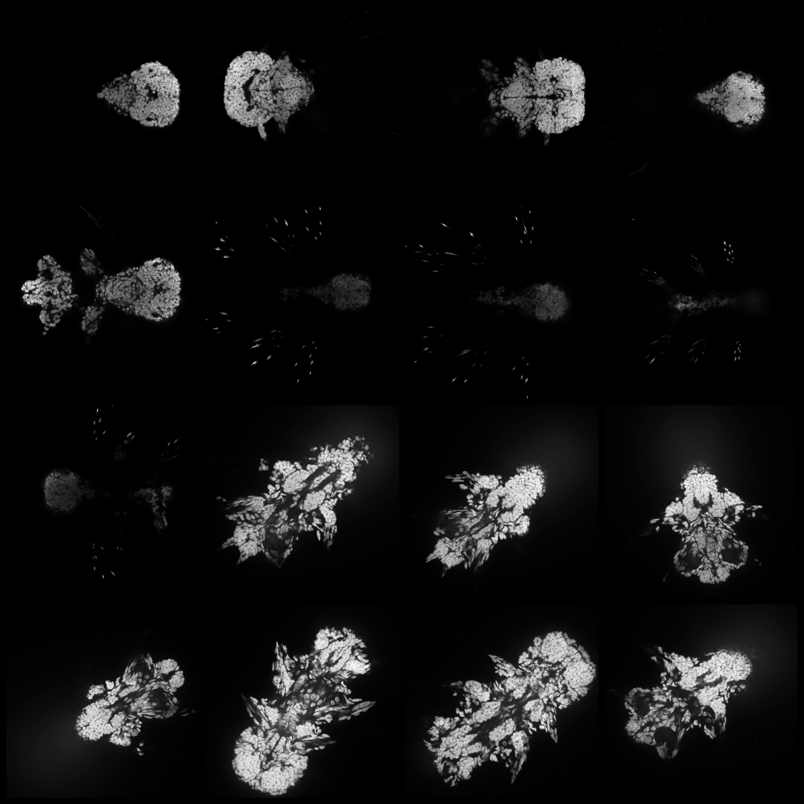

# platy_registration

Snakemake pipeline for creating a molecular atlas for 6 dpf *Platynereis dumrilii*.



## Installation

The pipeline uses multiple `conda` environments listed in `environments`. Steps of the pipeline are implemented as separate Python scripts in `pipeline_steps` which reuse some functions from the local package `platy_reg`. Install `platy_reg`:

```
pip install -e .
```

## Usage
Fill out the metadata table similarly to examples in `data_sample_lists`.

```
conda activate snakemake
sh snakemake_pipeline/run_all_snakemake_steps.sh
```